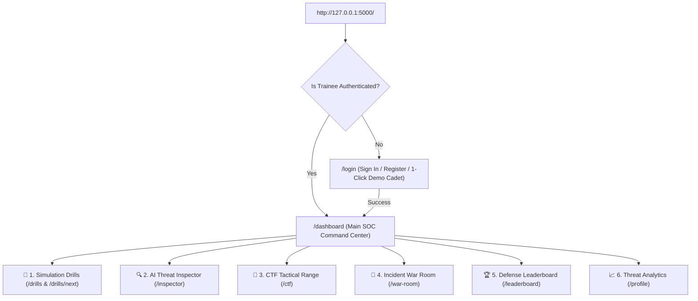

# ⚡ Threat Vector &mdash; Cybersecurity Awareness & Defensive Training SOC

> **A Beginner-Friendly, 100% Local Cybersecurity Web Application for College Presentations & Vivas**  
> Built with **Python (Flask)**, **SQLite**, **Scikit-learn (Machine Learning)**, and a **Professional Dark-Mode SOC Theme**.

---

## 📌 Project Overview
**Threat Vector** is a cybersecurity training and incident response platform designed to simulate the day-to-day workflow of a Security Operations Center (SOC) Tier-1/Tier-2 analyst. 

The application is architected as **one single integrated Flask app** running locally on `http://127.0.0.1:5000/`. It features **zero external cloud dependencies**, **no Docker**, **no React**, and **no complex setup**.

---

## 🏗️ Technology Stack

| Component | Technology | Rationale for College Viva |
| :--- | :--- | :--- |
| **Backend** | Python 3.12 + Flask 3.1 | Lightweight, Pythonic micro-framework; clean routing and session management. |
| **Database** | SQLite 3 (`database.db`) | Serverless, relational ACID database; zero configuration, uses pure SQL queries. |
| **Machine Learning** | Scikit-learn (`model.pkl`) | TF-IDF Vectorization + Logistic Regression classifier with feature weights and confidence probability. |
| **Frontend** | Semantic HTML5, CSS3, Vanilla JS | Modern SOC dark theme (Electric Cyan, Cyber Purple, Emerald, Crimson). No bloated NPM dependencies. |
| **Testing** | Python `unittest` (`test_app.py`) | Automated verification of all 8 core system flows. |

---

## 📂 Project Directory Structure

```text
threat_vector/
│
├── app.py                  # Main Flask application and route handlers
├── database.py             # SQLite schema, seed data, and query helper functions
├── train_model.py          # Scikit-learn TF-IDF + Logistic Regression training script
├── test_app.py             # Automated unit test suite
├── database.db             # Local SQLite database (auto-generated on launch)
├── model.pkl               # Serialized ML threat classifier pipeline
│
├── templates/              # Jinja2 HTML templates
│   ├── base.html           # Unified navigation bar, user HUD, flash alerts, and footer
│   ├── login.html          # Authentication entry point & 1-click viva demo login
│   ├── index.html          # Main SOC Dashboard (metrics, launchpad, audit log)
│   ├── drill.html          # Interactive Drill Runner (email simulator, indicator checklist)
│   ├── feedback.html       # Instant explainability, MITRE ATT&CK mapping, "Next Drill"
│   ├── inspector.html      # AI Threat & Link Inspector (ML inference & heuristics)
│   ├── ctf.html            # CTF Tactical Range (log forensics, web shells, ciphers)
│   ├── war_room.html       # Incident Response War Room (multi-phase crisis containment)
│   ├── leaderboard.html    # Defense Leaderboard (peer ranking & tier medals)
│   └── profile.html        # Analytics & Risk Profile (weakness diagnosis & certificate)
│
├── static/
│   └── style.css           # Custom SOC dark-mode theme stylesheet
│
└── data/
    └── scenarios.csv       # 28 realistic simulation scenarios (Phishing, OTP, BEC, etc.)
```

---

## 🚀 How to Run the Project Locally

### 1. Requirements
Ensure Python 3.10+ is installed on your machine. Install the lightweight dependencies:
```bash
pip install flask scikit-learn
```

### 2. Launch the Application
Run the Flask server:
```bash
python app.py
```
*(On Windows systems where `python` points to Microsoft Store stub, use the full python binary or `py app.py`)*

### 3. Open in Browser
Visit the single integrated link:
```text
http://127.0.0.1:5000/
```

---

## 🧭 Single-Link Application Flow



---

## 🎯 The Six Core Modules Explained

### 1. Simulation Drills (Continuous Training Engine)
- **Extensive Dataset:** 28 scenarios covering Phishing, Bank SMS OTP scams, CEO Gift Card BEC fraud, QR-code Quishing, Tech Support alerts, and Legitimate authenticated emails.
- **Continuous Flow Engine:** When clicking **"Next Drill"**, the system dynamically queries unanswered drills or seamlessly cycles through scenario IDs. Drills **never run out or crash abruptly**.
- **Interactive Runner:** Displays simulated email client headers (From, To, Subject, SPF/DKIM verification status), full formatted body, indicator selection checkboxes, and Safe/Malicious buttons.
- **Instant Explainable Feedback:** Detailed analysis of correctly identified indicators, technical threat breakdown, and MITRE ATT&CK mapping.

### 2. AI Threat & Link Inspector (Scikit-learn ML Feature)
- Trainees paste suspicious email text, headers, or URLs.
- Uses a **Scikit-learn Pipeline** combining **TF-IDF n-gram vectorization** with a **Logistic Regression classifier** (`C=2.5`, balanced class weights).
- Evaluates statistical token weights alongside **heuristic cybersecurity rules** (high-risk TLDs like `.top`, `.xyz`, `.ru`; urgency phrases like "expires in 2 hours"; credential harvesting triggers).
- Provides classification (`MALICIOUS` vs `SAFE`), a calibrated **confidence percentage**, top signal words, and SOC defense recommendations.
- Includes 5 one-click **Viva Demonstration Presets** for instant testing.

### 3. CTF Tactical Range (Capture The Flag)
6 hands-on tactical puzzles:
1. **SSH Brute Force Intrusion Detection:** Inspect `/var/log/auth.log` to identify attacking IP and breached user account (`flag{192.168.1.105_sysadmin}`).
2. **Obfuscated Web Shell Backdoor:** De-obfuscate an uploaded PHP script to discover the hidden authorization token (`flag{c99_backdoor_auth_token_9918}`).
3. **Intercepted C2 Cipher (ROT13):** Decrypt a Caesar-shifted threat actor beacon (`flag{rot13_challenge_decoded_success}`).
4. **PowerShell Base64 Forensics:** Decode an encoded Task Scheduler payload to reveal the C2 callback URL (`flag{http://evil-c2-listener.darknet/payload.ps1}`).
5. **SQL Injection Detective:** Review Apache access logs with `UNION SELECT` syntax to find target database table (`flag{admin_credentials}`).
6. **Ransomware Note Forensics:** Inspect LockBit ransom text to extract victim identifier (`flag{victim_id_882910_lockbit_recovered}`).

### 4. Incident Response War Room
- Simulates high-stakes emergency incident response under simulated time pressure.
- Scenarios: **Ransomware Outbreak on Domain Controller**, **Distributed Credential Stuffing**, **Executive Spear-Phishing Exfiltration**.
- Guides the trainee through 4 NIST/SANS incident phases:
  - **Phase 1: Detection & Triage**
  - **Phase 2: Containment**
  - **Phase 3: Eradication**
  - **Phase 4: Recovery & Post-Mortem**
- Trainees select operational commands and receive immediate tactical consequences and defense points.

### 5. Cybersecurity Defense Leaderboard
- Real-time ranking ladder benchmarking the trainee against peer SOC analysts (`alex_soc`, `sarah_infosec`, `marcus_cyber`).
- Displays Rank (#1-#3 Gold/Silver/Bronze), Total Score, Drills Completed, CTF Flags Captured, War Room Clearances, and Gamified Tier Titles (Cadet, SOC Analyst, Threat Hunter, CISO Defender).

### 6. Analytics & Personal Risk Profile
- Diagnostic threat readiness scorecard (Overall Readiness Index 0-100).
- Category-wise proficiency bars across all 7 attack vectors.
- **Automated SOC Weakness Diagnosis:** Detects the trainee's weakest category (e.g. *"High Susceptibility to Urgency Vectors"*) and provides specific behavioral remediation tips.
- Displays a formal **Certificate of Defense Readiness** suitable for export or printing.

---

## 🧪 Automated Testing
Run the automated test suite to verify all endpoints and features:
```bash
python test_app.py
```
*Output: `Ran 8 tests in 1.1s ... OK`*

---

## 🎓 College Viva Preparation
Read **`VIVA_GUIDE.md`** for 15+ comprehensive questions and answers frequently asked by external college examiners, including mathematical derivations of TF-IDF and Logistic Regression, relational schema design, and cybersecurity concepts!
