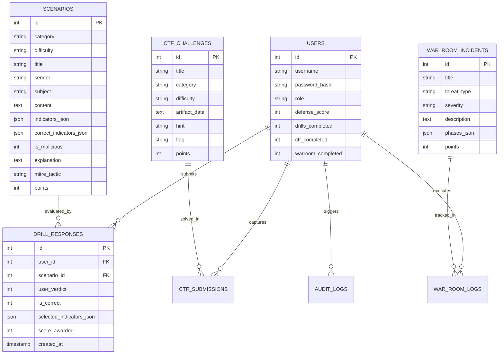

# 🎓 Threat Vector &mdash; College Viva & Presentation Preparation Guide

> **Prepared for 3rd-Semester College Computer Science / Cybersecurity Students**  
> Covers project defense, architecture rationale, mathematical theory, examiner questions, and a 5-minute live demo script.

---

## 📋 Table of Contents
1. [Project Elevator Pitch (30-Second Summary)](#1-project-elevator-pitch)
2. [5-Minute Live Presentation Demonstration Script](#2-5-minute-live-presentation-script)
3. [Top 15 College Viva Questions & Examiner Answers](#3-top-15-viva-questions--examiner-answers)
4. [Machine Learning Mathematical Intuition (TF-IDF & Logistic Regression)](#4-machine-learning-mathematical-intuition)
5. [Database Schema & Entity Relationship Explanation](#5-database-schema--erd)
6. [Cybersecurity Concepts & MITRE ATT&CK Mapping](#6-cybersecurity-concepts--mitre-attck)

---

## 1. Project Elevator Pitch

> *"Respected Examiners, our project is **'Threat Vector'**, an interactive, beginner-friendly cybersecurity awareness and training web application designed to train students and enterprise trainees in modern threat detection and incident response.*  
> *Unlike passive slide presentations, Threat Vector provides hands-on simulations across 28 real-world attack vectors, a continuous drill engine that dynamically tests trainees, an AI Threat Inspector powered by Scikit-learn to classify malicious text and links, an interactive CTF tactical range, a multi-phase Incident Response War Room, peer leaderboards, and an automated behavioral risk profiling engine.*  
> *The entire application runs locally on a single Flask server with an SQLite relational database, ensuring zero cloud overhead and high reliability for local enterprise or campus deployment."*

---

## 2. 5-Minute Live Presentation Script

Follow this sequence during your demonstration to impress the professors:

| Time | Action on Screen | What to Say to the Examiners |
| :--- | :--- | :--- |
| **0:00 - 0:45** | Open `http://127.0.0.1:5000/`. The app shows the **Login Screen**. Click **"⚡ Quick Demo Login as Cadet"**. | *"Notice our single-link architecture. All unauthenticated requests are guarded by session middleware and redirected to this login portal. For this presentation, we provide a 1-click authentication into our demo profile."* |
| **0:45 - 1:30** | The **Main Dashboard** opens. Point out the **Defense Readiness Index**, the accuracy percentage, and the live **SOC Audit Feed**. | *"Upon login, we arrive at the SOC Command Center. The dashboard calculates our personal Threat Readiness Score and tracks real-time audit logs stored in our local SQLite database."* |
| **1:30 - 2:45** | Click **"Drills"** from the top navbar. Show the simulated email client with headers (From, Subject, SPF status). Check 2 threat indicators and click **"Mark as MALICIOUS"**. | *"Here is our Simulation Drill module. The interface simulates a real corporate email client. We analyze headers, unmask lookalike domains (e.g. micros0ft with a zero), identify artificial urgency, and submit our verdict. Upon submission, our continuous engine provides instant explainable feedback and MITRE ATT&CK mapping."* |
| **2:45 - 3:15** | Click **"Next Drill ➔"**. Show that it immediately and seamlessly loads the next drill without stopping. | *"Notice the continuous pagination logic: when I click 'Next Drill', our query dynamically looks up uncompleted scenarios or smoothly cycles to ensure training never halts abruptly."* |
| **3:15 - 4:00** | Click **"AI Inspector"**. Click the preset button **"M365 Credential Phish"**, then click **"Run AI Deep Inspection"**. | *"Here is our Machine Learning feature. It uses Scikit-learn with TF-IDF Vectorization and Logistic Regression. Notice the 98% confidence score, the extracted heuristic flags, and the top signal words weighted by the classifier."* |
| **4:00 - 4:45** | Click **"CTF Range"** or **"War Room"**. Briefly show the log analysis artifact or multi-phase crisis containment. | *"Our platform also includes an interactive CTF Tactical Range for log analysis and cryptography, and an Incident Response War Room simulating ransomware outbreaks under time pressure."* |
| **4:45 - 5:00** | Click **"Analytics"**. Show the **Weakness Diagnosis** and the **Certificate**. | *"Finally, our Analytics module analyzes trainee mistakes, identifies their weakest threat vector, and issues a verified Defense Readiness Credential."* |

---

## 3. Top 15 Viva Questions & Examiner Answers

### Q1: Why did you choose Python Flask and SQLite instead of Node.js/React and MongoDB?
**Answer:**  
*"Flask is a lightweight, Pythonic micro-framework that integrates seamlessly with scientific Python libraries like Scikit-learn without needing external microservice APIs or Node subprocesses. SQLite is a zero-configuration, serverless relational database adhering strictly to ACID properties. It eliminates external database server overhead, allows the entire project to run from a single self-contained directory, and provides transparent SQL table structures that are easy to demonstrate and inspect during evaluation."*

---

### Q2: How does your Machine Learning model classify text and URLs?
**Answer:**  
*"We implement a two-stage hybrid threat classification engine:
1. **Statistical NLP Feature Extraction:** We use Scikit-learn's `TfidfVectorizer` with unigrams and bigrams (`ngram_range=(1, 2)`). This assigns numerical weights to words and URL fragments inversely proportional to their document frequency.
2. **Classification:** A `LogisticRegression` classifier calculates the linear combination $z = \mathbf{w}^T \mathbf{x} + b$ and passes it through the sigmoid function to produce a calibrated posterior probability $P(\text{Malicious} \mid x)$.
3. **Deterministic Heuristic Rules:** We augment the statistical model with regex checks for high-risk TLDs (`.top`, `.xyz`, `.ru`), brand typosquatting, and credential harvesting keywords."*

---

### Q3: What is TF-IDF and what is the mathematical formula?
**Answer:**  
*"TF-IDF stands for **Term Frequency-Inverse Document Frequency**:
$$\text{TF-IDF}(t, d, D) = \text{TF}(t, d) \times \text{IDF}(t, D)$$
Where:
- $\text{TF}(t, d) = \frac{\text{Count of term } t \text{ in document } d}{\text{Total terms in document } d}$
- $\text{IDF}(t, D) = \ln\left(\frac{1 + |D|}{1 + |\{d \in D : t \in d\}|}\right) + 1$

Terms that appear frequently in malicious samples (such as 'urgent', 'otp', 'verify', 'password') but rarely across standard communication receive high TF-IDF weights, allowing the classifier to identify threats reliably."*

---

### Q4: Why Logistic Regression instead of Deep Learning (like BERT or LSTMs)?
**Answer:**  
*"1. **Local Efficiency:** Logistic Regression trains in less than one second, consumes negligible RAM, and serializes into a compact 50KB `model.pkl` file. BERT requires gigabytes of VRAM and high-end GPUs.  
2. **Explainability & Viva Transparency:** Logistic Regression provides direct linear feature coefficients ($\mathbf{w}$). We can extract exactly which words contributed most heavily to the malicious verdict, making the model fully explainable to trainees and examiners."*

---

### Q5: Explain the 'Continuous Drill Flow' logic. How do you guarantee drills never run out?
**Answer:**  
*"In `app.py`, the `/drills/next` route implements a priority-based selection algorithm:
1. **Priority 1:** Find the next scenario whose ID is greater than the current scenario ID that the user has not completed:
   ```sql
   SELECT id FROM scenarios WHERE id > ? AND id NOT IN (SELECT scenario_id FROM drill_responses WHERE user_id = ?)
   ```
2. **Priority 2:** If no higher ID exists, find any uncompleted scenario across the entire table.
3. **Priority 3 (Mastery Wrap-Around):** If the trainee has completed all 28 drills, the system computes `(current_id % total_scenarios) + 1` to smoothly cycle back to scenario #1 in mastery mode. As a result, the application will never throw an IndexError or empty page."*

---

### Q6: How are user passwords stored securely?
**Answer:**  
*"Passwords are never stored in plain text. We utilize Werkzeug's `generate_password_hash()`, which implements PBKDF2/scrypt with a unique cryptographic salt per user. During authentication, `check_password_hash()` hashes the input password with the stored salt in constant time to prevent timing attacks."*

---

### Q7: What is MITRE ATT&CK?
**Answer:**  
*"The MITRE ATT&CK framework (Adversarial Tactics, Techniques, and Common Knowledge) is a globally accessible knowledge base of real-world cyber adversary behavior. In Threat Vector, every drill and ML detection maps directly to MITRE techniques, such as:
- **T1566.002:** Phishing: Spearphishing Link
- **T1566.001:** Phishing: Spearphishing Attachment
- **T1204.002:** User Execution: Malicious File
- **T1078:** Valid Accounts (Credential Stuffing)"*

---

### Q8: What is Typosquatting / Lookalike Domains?
**Answer:**  
*"Typosquatting is a social engineering technique where attackers register misspelled domain names resembling trusted brands to trick victims (e.g. `micros0ft-support.com` using a zero instead of the letter 'o', or `paypa1.com`). Our drill and inspector engines explicitly identify this indicator."*

---

### Q9: What is Quishing?
**Answer:**  
*"Quishing is **QR-code Phishing**. Attackers embed malicious URLs into QR codes and send them in emails or paste them on physical parking meters and cafeteria signs. Because traditional email security gateways only scan plain text and HTML links, QR codes in image attachments bypass link filters until scanned by mobile devices."*

---

### Q10: What is Business Email Compromise (BEC)?
**Answer:**  
*"BEC occurs when an attacker impersonates a senior executive (e.g. CEO or CFO) or compromises their legitimate email account to instruct employees to wire money, purchase gift cards, or release confidential W-2 tax documents under false pretenses of urgency and confidentiality."*

---

### Q11: How did you implement the SSH Brute Force CTF Challenge?
**Answer:**  
*"We provide an excerpt of Linux `/var/log/auth.log`. The attacker attempts multiple usernames from IP `192.168.1.105` generating `Failed password for...` lines until line 4 displays:
`Accepted password for sysadmin from 192.168.1.105 port 42110 ssh2`.
The trainee identifies the compromised user (`sysadmin`) and IP, constructing the flag: `flag{192.168.1.105_sysadmin}`."*

---

### Q12: How did you implement the Obfuscated Web Shell CTF Challenge?
**Answer:**  
*"The web shell script simulates a file upload vulnerability where a PHP script executes commands via `eval(base64_decode($_POST['cmd']))`. The attacker protects the shell with an MD5 hash check against variable `$k = 'c99_backdoor_auth_token_9918'`. The trainee inspects the code to recover this secret authorization flag."*

---

### Q13: What are the 4 phases of Incident Response used in the War Room?
**Answer:**  
*"Our War Room models the **NIST SP 800-61** Computer Security Incident Handling Guide:
1. **Detection & Triage:** Identify scope, affected systems, and isolate affected network segments (VLANs).
2. **Containment:** Invalidate compromised credentials (e.g. KRBTGT password reset), block malicious IP/domains, and sever C2 channels.
3. **Eradication:** Rebuild compromised servers from clean golden images and remove persistence mechanisms.
4. **Recovery & Lessons Learned:** Restore from air-gapped immutable backups and mandate hardware MFA."*

---

### Q14: How does the Automated Weakness Diagnosis work in the Profile module?
**Answer:**  
*"When the trainee visits `/profile`, the application queries `drill_responses` joined with `scenarios` and aggregates detection accuracy grouped by category (`Phishing`, `OTP Scams`, `Urgency`, etc.). If a trainee's accuracy in any category drops below 70%, the algorithm flags it as an active vulnerability and generates customized behavioral remediation advice."*

---

### Q15: How can this application be expanded in future versions?
**Answer:**  
*"Future enhancements could include:
1. Real-time SIEM syslog forwarding (CEF/Syslog) to integration with Splunk or Elastic.
2. Webhook notifications to Microsoft Teams or Discord for SOC team alerts.
3. Expanded interactive sandbox environments using isolated WebAssembly."*

---

## 4. Machine Learning Mathematical Intuition

### Sigmoid Activation Function in Logistic Regression
Given feature vector $\mathbf{x} \in \mathbb{R}^n$ representing TF-IDF weights:
$$z = \sum_{j=1}^n w_j x_j + b = \mathbf{w}^T \mathbf{x} + b$$
The probability that sample $\mathbf{x}$ is malicious ($y = 1$) is computed via the logistic sigmoid function:
$$P(y = 1 \mid \mathbf{x}) = \sigma(z) = \frac{1}{1 + e^{-z}}$$

```
Probability P(y=1)
    1.0 |                   .-------- (High Malicious Probability)
        |                 .'
    0.5 |---------------.'  (Decision Boundary at z=0)
        |             .'
    0.0 |__________.--'      (Benign / Safe)
        +----------------------------
                    z = w^T x + b
```

If $P(y = 1 \mid \mathbf{x}) \ge 0.5$, the prediction is **MALICIOUS**; otherwise, it is **SAFE**.

---

## 5. Database Schema & ERD


